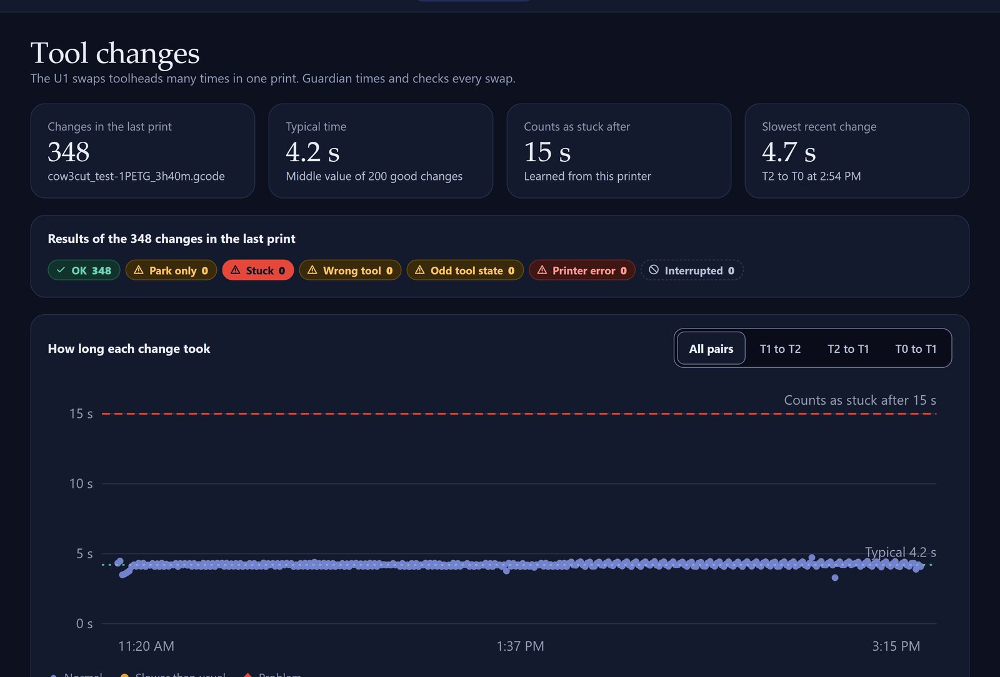

# U1 Guardian

An error clipping tool for the Snapmaker U1 3D printer. Open source (MIT). It runs on stock firmware and installs nothing on the printer.


## Why I made it

The U1's own error handling didn't tell me enough. When a print failed, I got an error code and a paused printer. I couldn't tell how it happened or why, and by the time I looked, the moment was gone.

So Guardian keeps a rolling buffer of the U1's camera. When something goes wrong, it saves the 30 seconds before the problem and the 15 seconds after, next to a timeline of what the printer reported and the printer's own logs from those minutes.

Then it started finding things I would have missed. On my own U1 it timed 2,599 tool changes over 10 days. Twelve failed, and 8 of the 11 printer errors named the same toolhead, T3. The printer only ever shows one error at a time, so I never saw that pattern until Guardian lined them up.

## What it does

- **Saves the footage from before a failure**, using the camera already in the U1. Each incident gets the clip, a timeline in clip time, and the printer's logs.
- **Times every tool change.** It learns what normal is on your printer and flags changes that get stuck, end on the wrong tool or report an error. A card shows which tool fails, in which print, and how often.
- **Shows what the camera should see.** It draws the printer from your G-code and puts it next to the live picture.
- **Optional AI** (local with Ollama, or your own API key) checks the plate, looks for spaghetti and writes a short diagnosis. Its answers are always marked as a guess.
- **Runs as a web page** on your own computer or a Raspberry Pi. No app, no account, nothing loaded from the internet.



## Honest limits

- Tested on one U1 (firmware 2.1.0.157) on Windows. Raspberry Pi and Linux are not run on real hardware yet.
- Auto pause has not paused a real print yet. Starting a print from the dashboard is unverified on the real U1.
- If any footage is missing, a clip says partial, never complete.
- Guardian shows evidence and patterns. It does not diagnose the printer for you.
- Anything about the U1 that was not seen on a real printer is marked `UNVERIFIED` in the code and docs. What was seen is in `docs/u1-discovery-notes.md`.
- I built it with AI coding assistance (Claude Code) and run it on my own printer.

## What Guardian sends to the printer

Guardian mostly reads. A few features send commands, each behind its own switch on the Settings page: the camera start below, auto pause, the dashboard buttons (pause, resume, stop), the camera setup moves and starting a print. Turn them all off and it only reads.

### Auto camera

This is the first exception. To get camera pictures without the
Snapmaker app open, it asks the printer to start its camera for the local network (`camera.start_monitor`, domain
`lan`). That is the same request the app sends. It does not move, heat or pause anything, and Guardian never turns
the camera off, so it cannot cut off the app. Each request is logged.

Set `camera.keepalive` in your config:

- `printing`: only while a print is running or paused. Idle printers are left alone.
- `always` (default): also when idle, so the live camera is always on.
- `off`: never. Guardian is then fully read only.

The printer's log showed no cloud upload for these local sessions (the app's own sessions do upload). That is
based on the log only.

### Auto pause

If Guardian finds a problem and the printer did not pause by itself, Guardian pauses the print. It waits 10 s first
(the printer's own camera check usually pauses by itself). It uses Moonraker's normal pause request, the same as the
pause button in Fluidd. It never resumes or cancels. You resume from the printer or the app.

Problems that can pause a print (each can be turned off): build plate not clear, spaghetti, residue, dirty nozzle
(all from the printer's own camera check), a tool change that is stuck, ends on the wrong tool or reports an error,
and a filament feed error. Guardian has not paused a real print yet.

Guardian has no camera AI of its own. "Build plate not clear" and the other camera checks come from the printer.

## Local AI (optional)

Guardian can use a local AI model to look at the camera and to explain incidents. It is off until you turn it on.
Nothing is sent to the internet. It runs with [Ollama](https://ollama.com/download), a free program (like FFmpeg).
When you turn on local AI and Ollama is missing, the Settings page offers to install it for you. On Windows Guardian
does that with winget (Microsoft's package manager). On Linux it shows the one command to run, because Ollama's
installer needs your password. Then pick and download a model on the Settings page:

- Qwen2.5-VL 7B: about 6 GB, better
- Gemma 3 4B: about 3.3 GB, faster

What it does:

- **Build plate check** in the first 90 s of a print. Two pictures 5 s apart must both show something on the plate.
- **Failure check** every 60 s during a print (spaghetti, a part that broke loose, a blob on the nozzle). A positive
  answer is checked again 10 s later.
- Both can pause the print through auto pause. You can turn that off per check.
- **Diagnosis**: after a print stops or fails, the AI reads the timeline, tool changes, printer logs and three pictures,
  and writes what probably happened and what to check. It shows on the incident page and is emailed if email is on.
  It is always marked as an AI guess.

### Online AI with your own API key

Instead of Ollama you can use an online AI service with your own API key: any OpenAI-compatible service (OpenAI,
OpenRouter, Groq, Google Gemini's OpenAI-compatible address, and others) or Anthropic (Claude). Pick it on the Settings
page, type the model name, and paste your API key in the AI box. Guardian keeps the key in a separate `secrets.json`
file in its data folder (readable only by you on Linux). It is never shown again, never put in an export, and only
sent to the service you picked. If you prefer, put it in an environment variable (default `GUARDIAN_AI_KEY`) or the
`.env` file instead. The environment variable wins. **Privacy:** with an online service, the camera pictures and printer logs for each check
go to that company, and it may cost money per check. Local AI keeps everything on your network.

You need a graphics card or a fast computer for local AI. A Raspberry Pi is too small for the local models, but it can
use an online service or Ollama on another computer. A Pi can use Ollama on
another computer (set the Ollama address). How well the models judge U1 pictures has not been tested yet.

### Printer controls

The dashboard has Pause, Resume and Stop buttons while a print runs. Each asks you to confirm. Stop asks you to
type STOP, because a stopped print cannot be resumed. They use Moonraker's normal requests, the same as Fluidd.
Guardian only resumes or stops a print when you click. Turn the buttons off on the Settings page if you like.

When the printer is idle, the dashboard also has **Reprint last file**, **Print a file** and **Upload a file**. Each asks
you to confirm and to tick that the plate is empty. The dialog shows the live camera and a button that raises the bed (home, back middle, 5 mm) so you can see the plate. Take a finished print off the plate first. Upload only sends the file. It does not start a print. These
buttons never show during a print, and Guardian never starts a print by itself. Turn them off on the Settings page
(Show Reprint, Print a file and Upload). UNVERIFIED on the real U1 until the first run: it uses Moonraker's normal
`printer.print.start` and file upload.

### Live camera

The dashboard shows the printer camera while a print runs (or all the time if Auto camera is set to Always). It uses
the pictures Guardian already saves, about 1 to 2 a second, so watching adds no load on the printer.

## Camera setup (for the print check)

Settings, Camera setup. Guardian needs to know where the camera looks to compare the camera with the print file.
When you open the page, Guardian asks you to confirm the build plate is empty (type EMPTY), then homes the printer and
parks the toolhead at the back middle, raises the bed to the top, saving a picture at 30 mm, 7 mm and 5 mm. Click the 4 plate corners on the pictures and press
Save. If the drawn parts do not sit on the real ones, press Turn or Mirror. This is the only time Guardian moves the
printer. It never does it during a print, and you can turn it off in Settings, Printer controls.

## Settings page

Open `/settings` on the dashboard. Changes apply right away and are saved to `settings.yaml` in Guardian's data
folder. `config.yaml` is never rewritten. Printer address, camera address and API keys stay in `config.yaml` and
environment variables. If the dashboard is reachable from your network, it needs a token (see `api.token`).

## Platforms

| Platform | Tested |
|---|---|
| Windows 11 | capture, incidents and tests run here |
| Raspberry Pi 3B+ | not yet |
| Linux, macOS | not yet |

## Run it

```
copy config.example.yaml config.yaml
python -m guardian.main --config config.yaml
```

Then open http://127.0.0.1:8080/ in a browser. The API only listens on this computer unless you change `api.bind`. If you do, set a token (`api.token` or the `GUARDIAN_API_TOKEN` environment variable). Recordings can show the inside of your home or workshop, so treat them as private.

## Email alerts (optional, bring your own key)

Guardian can email you when an incident starts and again when the clip is ready. It uses
[Resend](https://resend.com). Guardian does not include a key and never pays for your email.
You make your own free Resend account and key, so any cost is between you and Resend.

1. Make a free account at [resend.com/signup](https://resend.com/signup).
2. Open [resend.com/api-keys](https://resend.com/api-keys), click Create API key (sending access is enough) and copy it.
   Resend shows it only once. Resend's own guide: [resend.com/docs/create-an-api-key](https://resend.com/docs/create-an-api-key).
3. On Guardian's Settings page, under Email alerts, paste the key and click Save key. It is kept in a separate
   `secrets.json` in Guardian's data folder, never shown again and never put in an export. (You can also use the
   environment variable `GUARDIAN_RESEND_KEY` or `RESEND_API_KEY`, for example in a `.env` file. It wins.)
4. Turn on "Send email alerts", add your address under "Send to", save, and click "Send test email".

Resend's test sender (`onboarding@resend.dev`) only delivers to the email address of your own Resend
account. To send to other people, verify your own domain in Resend and change `from_addr`.
Messages are plain text. Clips are never attached, so video never leaves your network.

## Raspberry Pi

See `docs/pi-setup.md`. The install script and service file are untested on a real Pi so far.

## Requirements

- Python 3.11 or newer
- FFmpeg and ffprobe on your PATH (not bundled)

## Dev setup (Windows cmd)

```
py -3.11 -m venv .venv
.venv\Scripts\activate
pip install -e .[dev]
pytest
```

Run the simulation (100 fake triggers, checks each clip, about 1 to 2 minutes):

```
python tools/simulate_trigger.py
python tools/simulate_trigger.py --live
```

## License

MIT. See LICENSE.
