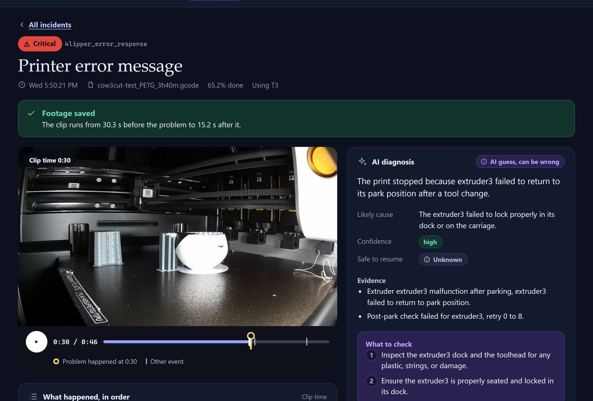

# U1 Guardian

Error clipping for the Snapmaker U1. When a print fails, it saves the camera footage from just before and just after, with a timeline of what the printer reported. Open source (MIT), runs on stock firmware.



## Why I made it

The U1's error handling didn't tell me enough. A print would fail and I'd get an error code and a paused printer. I couldn't tell how or why it happened, and by the time I got there, the moment was over.

So Guardian keeps the last 30 seconds of the U1's camera. When something goes wrong, it saves that clip plus 15 seconds after, next to the printer's own events and logs.

It found something I'd missed. Toolhead 4 kept failing to park. Guardian timed 2,599 tool changes over 10 days, and 8 of the 11 printer errors named T3. The printer only shows one error at a time, so I never saw the pattern.

## What it does

- Saves video from before a failure, using the camera already in the U1
- Times every tool change and shows which tool fails, in which print, and how often
- Draws what the camera should see from your G-code and shows it next to the live picture
- Optional AI check of the plate and short notes on why a print stopped
- Runs as a web page on your own computer. No account, no cloud.


## Install

You need Python 3.11 or newer and FFmpeg. On Windows, `winget install Gyan.FFmpeg` and open a new terminal.

```
git clone https://github.com/tregt15/u1-guardian
cd u1-guardian
py -3.11 -m venv .venv
.venv\Scripts\activate
pip install -e .
copy config.example.yaml config.yaml
```

On Linux, use `python3 -m venv .venv`, `source .venv/bin/activate` and `cp`. For a Raspberry Pi, see `docs/pi-setup.md`.

Open `config.yaml` and set `printer.host` to your U1's address and `camera.snapshot_url` to
`http://<your U1>/server/files/camera/monitor.jpg`. Then:

```
python -m guardian.main --config config.yaml
```

Open http://127.0.0.1:8080. Most options are on the Settings page. To reach it from another device, set `api.bind: 0.0.0.0` and an `api.token`.

If Guardian can't find FFmpeg, set `camera.ffmpeg_path` and `camera.ffprobe_path` in `config.yaml`.

## What it sends to the printer

Mostly it only reads. A few features send commands, and each has its own switch in Settings:

- **Auto camera:** turns the U1 camera on for your local network, the same request the Snapmaker app sends
- **Auto pause:** pauses the print after 10 seconds if the printer didn't pause itself. It never resumes or cancels.
- **Dashboard buttons:** pause, resume, stop, reprint, print a file and upload a file. Only when you click and confirm.
- **Camera setup:** homes the printer and raises the bed once, only when idle and after you confirm the plate is empty

Turn them all off and Guardian only reads.

## Optional AI

Off until you turn it on. Use a local model through [Ollama](https://ollama.com), or your own API key for an OpenAI-compatible service or Claude. With an online service, the camera pictures for each check go to that company. The key is kept in `secrets.json` in the data folder and is never shown or exported.

## Email alerts

Optional. Add your own [Resend](https://resend.com) key and address on the Settings page. Clips are never attached.

## Tests

```
pip install -e ".[dev]"
pytest
```

What was seen on a real U1 is in `docs/u1-discovery-notes.md`.

## License

MIT
